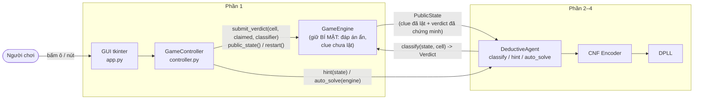
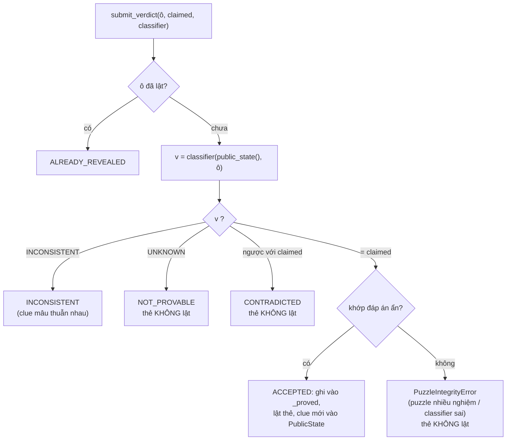

# Phần 1 — Trò chơi, Game Engine và Giao diện (GUI)

> Người thực hiện: Nguyễn Trọng An (24120017). Nhánh: `feat/p1-engine-gui`.
> Ảnh chụp màn hình đặt trong `docs/report/img/` (xem mục 6).

## 1. Giới thiệu trò chơi

Griductive là trò chơi suy luận trên lưới N×N (N = 3, 4 hoặc 5). Mỗi ô là một nhân vật có
**tên** và **nghề nghiệp**; trạng thái ẩn của nhân vật là **Criminal** (tội phạm) hoặc
**Innocent** (vô tội). Ô được gọi bằng *cột + hàng*: cột là chữ cái A, B, C… từ trái sang,
hàng là số 1, 2, 3… từ trên xuống (ví dụ C2 = cột C, hàng 2).

Mỗi nhân vật có một **thẻ**, mặt sau ghi một **clue** (manh mối). Lúc đầu chỉ vài thẻ được lật
ngửa; các thẻ khác úp. Mọi clue đã lật đều **đúng**, kể cả clue của tội phạm (không phải trò
"người nói thật / kẻ nói dối"). Tên và nghề không mang ý nghĩa logic trừ khi clue nhắc tới.

**Cách chơi.** Người chơi chọn một nhân vật và tuyên bố CRIMINAL hoặc INNOCENT (gọi là *verdict*).
Luật quan trọng nhất là **không được đoán**: verdict chỉ được chấp nhận khi nó *bắt buộc đúng*
theo thông tin công khai hiện có. Verdict đúng thì thẻ được lật, người chơi nhận thêm một clue mới
và tiếp tục suy luận. Trò chơi kết thúc khi mọi nhân vật đã được xác định. Một puzzle hợp lệ
có đúng một cách gán Criminal/Innocent thỏa mọi clue.

Các loại clue bắt buộc: FACT, SAME, DIFFERENT, EXACTLY, AT_LEAST, AT_MOST. "Vùng" (region)
có thể là một hàng, một cột, các ô kề một ô (8 hướng, không tính chính nó) hoặc một danh sách ô.

## 2. Kiến trúc tổng thể

Hai vai trò được tách riêng theo đề:

| Thành phần | Biết gì | Không được biết |
|---|---|---|
| **GameEngine** (trọng tài) | toàn bộ puzzle, đáp án ẩn, clue chưa lật | — |
| **Logic Agent** (người chơi máy) | `PublicState`: clue đã lật + verdict đã chứng minh | đáp án ẩn, clue chưa lật |
| **GUI** | `PublicState` (qua controller) | đáp án ẩn, clue chưa lật |

Engine *không tự suy luận*. Khi nhận verdict, Engine hỏi một **classifier** (hàm do Phần 4 cung
cấp: `DeductiveAgent.classify`) với *chỉ* `PublicState` và ô được hỏi, rồi dựa vào câu trả lời
để chấp nhận hay từ chối. Nhờ vậy Engine là "trọng tài", Agent là "người chơi", không bên nào
làm việc của bên kia.

## 3. Cấu trúc dữ liệu và biểu diễn trạng thái

Các cấu trúc dùng chung nằm ở `core/models.py`:

- `Status` = CRIMINAL | INNOCENT (trạng thái thật).
- `Verdict` = CRIMINAL | INNOCENT | UNKNOWN | INCONSISTENT (kết quả phân loại của Agent).
- `SubmitResult` = ACCEPTED | NOT_PROVABLE | CONTRADICTED | ALREADY_REVEALED | INCONSISTENT.
- `Clue(id, type, targets, fact_status, region, k, extra)`: clue có cấu trúc; `id = "clue_<ô>"`.
- `Region(kind, ref, cells)`: kind ∈ ROW / COL / NEIGHBORS / CELLS.
- `Character(cell, name, profession)`: **không** có trường trạng thái.
- `PublicState(size, characters, revealed_clues, proved)`: thứ duy nhất Agent/GUI nhìn thấy.

**Puzzle** (`core/puzzle_io.py`) được đọc từ file JSON:
`size`, `initial_revealed`, `characters[]` (mỗi phần tử có `cell`, `name`, `profession`,
`status` *ẩn*, `clue`). Hàm `load_puzzle` kiểm tra lỗi và báo bằng tiếng Việt (`PuzzleError`):
thiếu trường, số nhân vật ≠ N², ô trùng hoặc nằm ngoài lưới, status sai, tên trùng, loại clue
không hợp lệ, vùng không tồn tại, k ngoài khoảng [0, |vùng|], SAME/DIFFERENT có hai ô giống nhau,
`initial_revealed` rỗng hoặc chứa ô không tồn tại, file JSON hỏng.

**Trạng thái game** trong `GameEngine` chỉ gồm hai biến:

- `_proved: dict[ô → Status]`: các ô đã xác định (thẻ đã lật);
- `_revealed: list[ô]`: thứ tự lật thẻ (để clue hiện theo đúng thứ tự).

Thẻ *đã lật* ⇔ ô nằm trong `_proved`. Mọi thứ khác (đáp án ẩn, clue chưa lật) nằm trong
`_puzzle` và **không bao giờ** được trả ra ngoài. `public_state()` tạo một bản sao gồm
danh sách nhân vật, các clue của thẻ đã lật (theo thứ tự lật) và `proved`.
`get_clue(ô)` chỉ trả clue của thẻ đã lật; thẻ còn úp → `PermissionError`.

## 4. Cơ chế xác nhận verdict và lật thẻ

Classifier của Phần 4 trả lời bằng hai câu hỏi SAT:
KB ∧ ¬Cᵢ là UNSAT ⇒ chắc chắn CRIMINAL; KB ∧ Cᵢ là UNSAT ⇒ chắc chắn INNOCENT;
cả hai SAT ⇒ UNKNOWN; KB tự UNSAT ⇒ INCONSISTENT.

- **NOT_PROVABLE**: thông tin hiện có *chưa đủ*, cả hai khả năng đều còn mở. Ví dụ: chỉ biết
  "có đúng 1 tội phạm trong các ô kề A1 (B1, A2, B2)" thì B1 có thể là tội phạm, cũng có thể
  không. Tuyên bố "B1 là CRIMINAL" lúc này bị từ chối dù có thể đúng, vì đó là **đoán**.
- **CONTRADICTED**: thông tin hiện có *chứng minh điều ngược lại*. Ví dụ clue "không có tội phạm
  nào trong các ô kề C3" đã lật, người chơi lại nói "B2 là CRIMINAL" (B2 kề C3) → từ chối.
- Mọi verdict bị từ chối giữ **nguyên** trạng thái game: không lật thẻ, không lộ clue ẩn
  (được kiểm chứng bằng test `test_rejected_verdict_does_not_change_state`).
- Engine chỉ đối chiếu với đáp án ẩn **sau khi** classifier đã chứng minh được verdict. Nếu đáp án
  ẩn khác thì đây là lỗi dữ liệu, không phải lỗi người chơi; Engine báo `PuzzleIntegrityError`
  thay vì lật sai thẻ. (Bản đầu dùng `assert`, nhưng `assert` bị tắt khi chạy `python -O`
  và làm sập GUI, nên đã thay.)

## 5. Giao diện (GUI)

GUI viết bằng **tkinter** (thư viện có sẵn của Python), chạy bằng `python main.py gui`.
Code chia hai lớp:

- `gui/controller.py` (`GameController`): toàn bộ xử lý khi bấm nút. Không phụ thuộc tkinter nên
  được kiểm thử tự động bằng pytest.
- `gui/app.py` (`GriductiveApp`): chỉ vẽ dữ liệu lấy từ controller và chuyển sự kiện chuột/phím.

Các thành phần trên màn hình (ảnh: `img/p1_overview.png`):

1. **Thanh công cụ**: Load (mở file `.json`), Restart (chơi lại), Hint (gợi ý), Auto Solve
   (tự giải); bên cạnh là tên puzzle và tiến độ "đã biết x/N²".
2. **Lưới N×N** với tọa độ cột A, B, C… và hàng 1, 2, 3…. Mỗi thẻ hiện tọa độ, tên, nghề:
   - thẻ úp: nền **xám**, ghi "?  (thẻ úp)", không có clue;
   - thẻ đã lật: nền **đỏ** (TỘI PHẠM) hoặc **xanh** (VÔ TỘI) và câu clue.
3. **Chọn ô** bằng chuột (viền xanh dương), rồi bấm **CRIMINAL** / **INNOCENT**
   (phím tắt C / I).
4. **Danh sách clue đã lật**. Bấm vào một clue (hoặc bấm vào thẻ đã lật) thì các ô mà clue đếm
   hoặc nhắc tới được **viền cam**; với clue "ô kề X", ô X được viền cam nét đứt.
5. **Khung thông báo** có màu: xanh = chấp nhận, cam = NOT_PROVABLE, đỏ = CONTRADICTED.
6. **Thanh trạng thái** cho biết classifier đang dùng và chú thích màu.

**Clue thành câu dễ đọc** (`gui/clue_text.py`): file lưu clue dạng cấu trúc, GUI ghép thành câu,
ví dụ `{"type": "EXACTLY", "k": 1, "region": {"kind": "ROW", "ref": "2"}}` →
"Có đúng 1 tội phạm trong hàng 2."; `EXACTLY 0` → "Không có tội phạm nào trong …".
Clue mở rộng chưa biết định dạng được hiện dạng thô, không làm sập GUI.

**Tô sáng** (`gui/highlight.py`): ưu tiên dùng `logic.regions.cells_of` của Phần 2; nếu Phần 2
chưa cài thì dùng hàm phụ `core.grid.region_cells`. Vùng nằm trong `extra` của clue mở rộng
(ví dụ COMPARE có hai vùng) cũng được tô.

**Hint / Auto Solve**: GUI gọi `agent.hint(state)` và `agent.auto_solve(engine)` của Phần 4. Hint tô
viền tím ô có thể chứng minh tiếp theo, và chọn sẵn clue đã lật có nhắc tới ô đó. Auto Solve
in từng bước của deduction trace vào khung thông báo. Khi Phần 4 chưa xong, GUI bắt
`NotImplementedError` và báo "đang chờ Phần 4" thay vì sập.

**Không làm lộ bí mật**: controller chỉ gọi API công khai của Engine (`from_file`, `restart`,
`public_state`, `submit_verdict`, `is_solved`, `name`) và không bao giờ đọc `engine._puzzle`.
Dữ liệu để vẽ thẻ (`CellView`) chỉ có `status` khi thẻ đã lật.

## 6. Hình ảnh minh họa

| Ảnh | Nội dung |
|---|---|
| `img/p1_overview.png` | Màn hình sau khi Load puzzle |
| `img/p1_accepted.png` | Verdict được chấp nhận: thẻ đổi màu, clue mới hiện ra |
| `img/p1_not_provable.png` | Thông báo NOT_PROVABLE, thẻ vẫn úp |
| `img/p1_contradicted.png` | Thông báo CONTRADICTED |
| `img/p1_highlight.png` | Chọn một clue, các ô liên quan được viền cam |
| `img/p1_hint_autosolve.png` | Hint / Auto Solve (sau khi Phần 4 xong) |

## 7. Kiểm thử

`pytest` chạy các test của Phần 1:
`test_puzzle_io.py` (tọa độ, vùng, 13 loại lỗi file), `test_engine.py` (chấp nhận / từ chối,
không đổi trạng thái khi bị từ chối, PublicState không chứa bí mật, classifier chỉ nhận
PublicState), `test_gui_text_highlight.py`, `test_gui_controller.py` (toàn bộ luồng nút bấm, kể cả
khi Phần 4 chưa xong hoặc agent bị lỗi) và `test_dev_classifier.py` (chơi hết puzzle 3×3 và 4×4
mẫu mà không cần đoán).

Trong lúc chờ Phần 4, nhóm dùng một **classifier tạm** (`gui/dev_classifier.py`, chỉ dùng để
phát triển): thử mọi cách gán cho các ô mà clue đã lật nhắc tới, *chỉ* dựa trên `PublicState`.
Khi `DeductiveAgent.classify` hoạt động, GUI tự chuyển sang agent thật (CNF + DPLL), thanh
trạng thái đổi thành "Classifier: DeductiveAgent (Phần 4)".

## 8. Hạn chế

- `puzzle_io` chỉ kiểm tra *cấu trúc* file. Việc đáp án ẩn có thỏa mọi clue và nghiệm có duy nhất
  không do evaluator (Phần 2) và uniqueness check (Phần 4) đảm nhận.
- Lưới tối đa 9×9 (hàng chỉ có một chữ số). Đề chỉ yêu cầu 3–5.
- Auto Solve hiện kết quả cuối cùng và trace dạng chữ, chưa có hiệu ứng lật từng thẻ.
